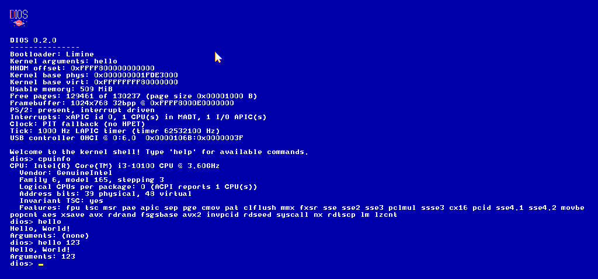

# DIOS

DIOS stands for D Incomplete Operating System (because it is a toy project that will likely never be feature-complete). It is a minimal x86_64 OS kernel written in D with some parts in assembly. It is tested on a real hardware and emulators like VirtualBox and QEMU. The main purpose of this project is demonstrating D's fitness for system development. I've written it initially in D1/GDC and recently ported to D2/LDC.

You are free to use this code as a base to create your own kernel. PRs implementing real-world OS features are welcome. The code is a bit messy but readable.

DIOS is an ELF kernel that requires a bootloader to run. Default setup in this repo uses [Limine](https://github.com/limine-bootloader/limine) for booting from the CD-ROM. Both UEFI and BIOS are supported. You can also make a bootable USB stick with the DIOS ISO image using [Ventoy](https://www.ventoy.net/en/index.html).

## Features

- Boots using Limine startup protocol
- UEFI/GOP framebuffer
- IDT
- GDT
- Bitmap page-frame allocator
- HPET timer (plus legacy PIT fallback)
- I/O APIC, Local APIC
- Interrupt-driven PS/2 keyboard
- PCI enumeration
- xHCI driver, HID mouse
- A simple shell with built-in kernel commands.

DIOS is planned as a graphical OS: all rendering features are built into the kernel (but there's no full-featured GUI yet).

DIOS is now 64-bit only, x86 support was dropped.

## Kernel Shell Commands

- `help` - show the command list
- `about` - kernel version information
- `mem` - physical memory statistics
- `uptime` - time since boot
- `clock` - clock source and timer status
- `irq` - interrupt controller status
- `pci` - enumerate PCI functions
- `history` - show recent commands
- `echo TEXT` - print TEXT
- `poweroff` - shut down the computer.

## Code Structure

- `src/dios` contains the kernel code:
  - `src/dios/bootloader` - boot protocol; currently only Limine protocol is implemented. Multiboot support was dropped
  - `src/dios/core` - kernel modules, including core drivers necessary to run the main I/O loop
- `src/main.d` - the kernel entry point
- `src/object.d` - D runtime stub.

## Building

Prerequisites:

* Recent LDC compiler
* [NASM](http://www.nasm.us)
* [xorriso](https://github.com/Distrotech/xorriso) to generate a bootable CD image

Run `./build.bat` to compile the kernel (`cdroot/kernel64.bin`) and generate `dios64.iso`.
