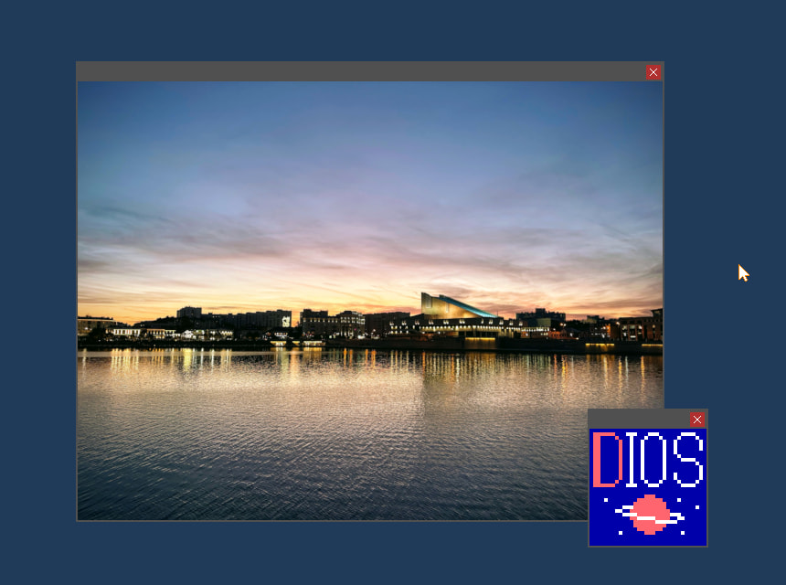
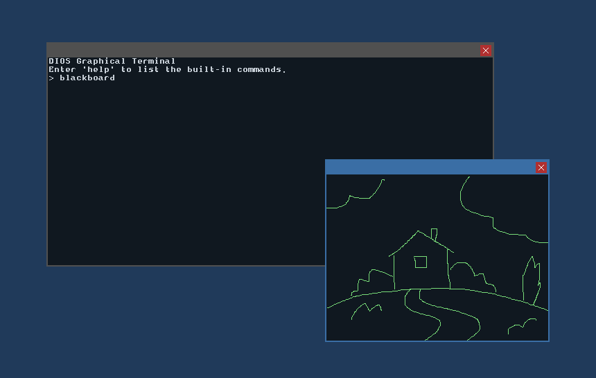

# DIOS


DIOS stands for *D Incomplete Operating System* (because it is a toy project that will likely never be feature-complete). It is a minimalistic multi-tasking x86_64 OS kernel written in [D language](https://dlang.org) with some small parts in NASM assembly, plus a simple system environment also fully written in D. It is tested on a real hardware and emulators like VirtualBox and QEMU. I've written it initially in D1/GDC and ported to D2/LDC in 2025.

Although many features of DIOS are inspired by Unix, this is only to keep a degree of familiarity with existing systems for better user experience; making a full Unix clone is not the goal of the project. The main purpose is experimenting with OS design and demonstrating D's fitness for system development.

You can use DIOS as a basis for creating your own operating system! PRs implementing new features are welcome. The code is a bit messy but readable.

[](media/screenshot2.jpg)
[](media/screenshot3.png)

## Notes

- DIOS is a monolithic kernel that contains all the device drivers in itself. It is mostly designed for modern computers and doesn't support legacy hardware
- DIOS is now 64-bit only, x86 support was dropped
- DIOS is planned as a graphical OS, but there's no built-in GUI toolkit yet. Graphical features are work-in-progress
- DIOS is an ELF kernel that requires a bootloader to run. Currently only [Limine](https://github.com/limine-bootloader/limine) boot protocol is supported; both UEFI and BIOS are supported
- Default setup in this repo assumes booting from the CD-ROM, but you can also make a bootable USB stick with the DIOS ISO image using [Ventoy](https://www.ventoy.net/en/index.html). Simply copy the `dios64.iso` file onto the flash drive that has Ventoy installed.

## Features

- UEFI GOP (or VESA) framebuffer
- IDT, GDT
- Bitmap page-frame allocator
- Low-latency HPET-based timer (plus legacy PIT fallback). System tick frequency is 1000 Hz
- Minimal ACPI table reader
- I/O APIC, Local APIC
- CMOS date-time
- PCI enumeration
- xHCI driver. USB keyboard and mouse; mass storage devices (FAT32, exFAT); USB hot-plug support; USB hubs support
- PS/2 keyboard and mouse
- A shell with built-in kernel commands
- Basic multi-tasking userspace in Ring 3; system calls; a simple standard library for applications
- Virtual filesystem; multiple mount points
- RAM filesystem image loaded from a TAR archive (`rootfs.tar`) provided by the bootloader
- Userspace graphics server (GFXD), windowed applications
- Simple image viewer.

Note: all storage devices are mounted as read-only by default. FAT32 partitions can be remounted as read/write; exFAT is currently read-only.

## Command Shell

After successful initialization, the kernel immediately starts a graphics mode and runs its own shell at the background. You can always revert to the shell with `Ctrl+F1` and back to graphics with `Ctrl+F2`. Available shell commands are listed [here](doc/commands.md).

In the graphics mode, you should see a user terminal window. Terminal's possibilities are very limited at the moment, but you already can run built-in programs. For example:

- `time` - prints current date and time
- `file /home/hello.txt` - prints a text file
- `image /home/lake.tga` - displays a TGA image.

Full list of built-in programs is [here](doc/programs.md).

The repo also contains a number of simple examples of what can be done in DIOS userspace. They are included in the prebuilt ISO image:

- `hello` - "Hello, World!" program that prints its arguments
- `memtest` - dynamic memory allocation test
- `math` - floating-point math functions test
- `random` - random number generator test
- `gfxdemo` - a graphical demo (simple painting app).

Applications are also written in D, but they actually can be written in any language that can make platform-independent ELF64 binaries.

## Code Structure

DIOS project consists of a several structural layers, each with its own workflow.

- `src/kernel` contains the kernel code:
  - `src/kernel/dios/bootloader` - boot protocol; currently only Limine protocol is implemented. Multiboot support was dropped
  - `src/kernel/dios/core` - kernel modules, including core drivers necessary to run the main I/O loop
  - `src/kernel/main.d` - the kernel entry point
- `src/ulib` contains the **ulib** runtime library code:
  - `src/ulib/ulib/dios` - implements basic [libc-like functionality](doc/ulib.md) on top of [DIOS syscalls](doc/sys_call.md)
  - `src/ulib/ulib/math` - elementary math functions
  - `src/ulib/ulib/gfx` - DIOS graphics protocol and userspace rendering API. Read more [here](doc/graphics.md)
  - `src/ulib/umain.d` - runtime entry point. Allocates an arguments array and calls compiler-generated `_Dmain`
- `src/user` contains userspace services and built-in programs:
  - `src/user/gfxd` - **GFXD**, the DIOS Graphics Server
  - `src/user/gterm` - **GTerm**, a graphical terminal
  - `src/user/time` - prints current UTC date and time
  - `src/user/timer` - a simple background timer program (`timer 10s &`)
  - `src/user/image` - work-in-progress image viewer. Currently supports only TGA format (`image img.tga &`, then start/switch to graphics mode)
- `src/demos` contains sample applications:
  - `src/demos/hello`
  - `src/demos/file`
  - `src/demos/dir`
  - `src/demos/memtest`
  - `src/demos/math`
  - `src/demos/random`
  - `src/demos/gfxdemo`

## ulib

ulib stands for "user library" (or, alternatively, "unfinished library" because, again, it is a hobby project that will likely never be finished). It is a low-level runtime library for DIOS applications written in D.

Most of its functions are libc-like and self-explanatory. Full list of them can be found [here](doc/ulib.md).

## GFXD

[GFXD](src/user/gfxd) is a graphics server and a window manager that allows other applications to draw graphics.

GFXD is a userspace program that is provided to the kernel as a binary module via Limine (see `limine.conf`). It must be present as `cdroot/user/gfxd.elf` before building the ISO image. DIOS repository provides a prebuilt GFXD binary for convenience.

The graphics server is started with `gfx start` command. `Ctrl+F1` switches back to the shell, `Ctrl+F2` shows the server, `Ctrl+F3` stops it.

## "Hello, World" application in D

```d
import ulib.dios;

void main(string[] args)
{
    uprintf("Hello, World!\n");
}
```

ulib is currently statically linked; DIOS doesn't support dynamic linking yet.

## Building

DIOS uses its own build system written in Python that compiles the entire system. It does the following:

- Compiles the kernel (by default `cdroot/kernel64.bin`)
- Compiles ulib (`rootfs/lib/libulib.a`)
- Compiles the userspace (programs in `rootfs/bin`)
- Builds the root filesystem image (`cdroot/rootfs.tar`)
- Generates a bootable CD image (`dios64.iso`).

Prerequisites:

- Recent [LDC](https://github.com/ldc-developers/ldc)
- [NASM](http://www.nasm.us)
- Python (for running the build script)
- [xorriso](https://github.com/Distrotech/xorriso) to generate a bootable CD image
- Optionally, [fstool](https://github.com/KarpelesLab/fstool) to generate a USB stick image for testing in QEMU.

Run `python build.py` to build everything.

Run `python build.py kernel` to build only the kernel.

Run `python build.py ulib` to build only ulib.

Run `python build.py user` to build only the userspace.

Userspace and sample programs (`src/demos`) can be built individually with DUB:

```
dub build
```

All *.elf binaries of the demos are automatically copied to `rootfs/bin`. To include them to the root filesystem, you should run `python build.py rootfs` to rebuild the image.
